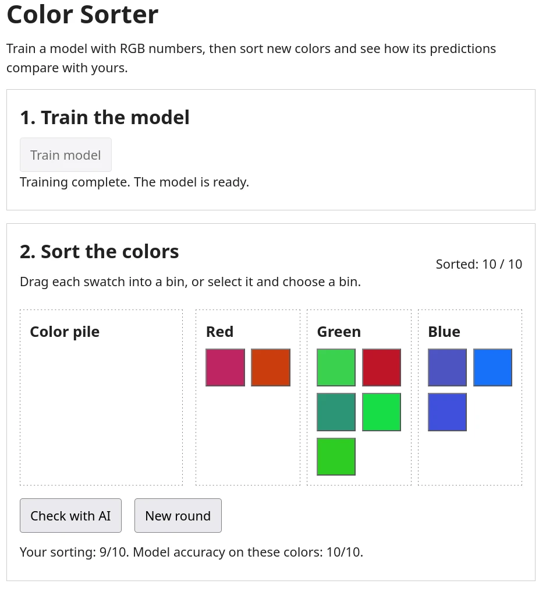

# TenserFlow.js

> Learning Objective: Using LLM assisted coding build a Machine Learning game.

Using [ml5.js](https://ml5js.org/) and the pre-existing code base, complete the project so that the user can drag sprites into bins and the AI will check if all items are in the correct bin and give a score.



## TODO

Complete the `trainModel()` and `classify()` methods in the `js/ML.js` file. Work through one step at a time and test after each change. The rest of the game is already implemented and should work once the ML code is complete.

## Example Prompts

Below are some example prompts you can use.
Feel free to modify them or write your own. Remember what ever AI tool you use, feed it the entire code base so it has context for your prompts.

```
Read the starter files and explain what `trainModel()` and `classify(color)` need to do for the game to use a trained model. Do not change any files.
```

```
In `js/ML.js`, create a helper that returns labeled RGB training examples for red, green, and blue. Return an array of objects with `red`, `green`, `blue`, and `label` properties. Make 40 examples for each color. Only change `js/ML.js`.
```

```
Implement `trainModel(updateProgress)` in `js/ML.js`. It should use the training examples to train a classifier that predicts a color label from RGB values. Save the trained model on the instance. Call `updateProgress` with status messages and finish only after training is complete. If training fails, let the error reach the caller. Use the ml5 documentation linked below. Only change `js/ML.js`.
```

```
Implement `classify(color)` in `js/ML.js`. Given an object with `red`, `green`, and `blue` values, use the trained model to return the predicted color label as a lowercase string. Report a clear error if the model has not been trained. Only change `js/ML.js`.
```

```
Review `js/ML.js` and check that `trainModel(updateProgress)` and `classify(color)` meet the requirements above and work with the existing game. Fix only problems in `js/ML.js`, then tell me how to test the game.
```

### Helpful docs

Feel free to read these with your human eyes or feed them to your AI so it hallucinates less.

- [ml5.js neuralNetwork reference](https://docs.ml5js.org/#/reference/neural-network) — creating a classifier, adding data, normalizing, training, and classifying.
- [JavaScript async functions](https://developer.mozilla.org/en-US/docs/Web/JavaScript/Reference/Statements/async_function) — using `async` and `await`.
- [JavaScript Array.from()](https://developer.mozilla.org/en-US/docs/Web/JavaScript/Reference/Global_Objects/Array/from) — making a set number of training examples.

## What to Submit

- URl to **your** git repository with the completed game code.
- Either edit this `README.md` file or create a separate file that documents the following:
    - Each prompt you used to build the game.
    - A short one sentence description of what the prompt was for. And where the project was before and after the prompt.
        - **This documentation needs to be detailed**.
